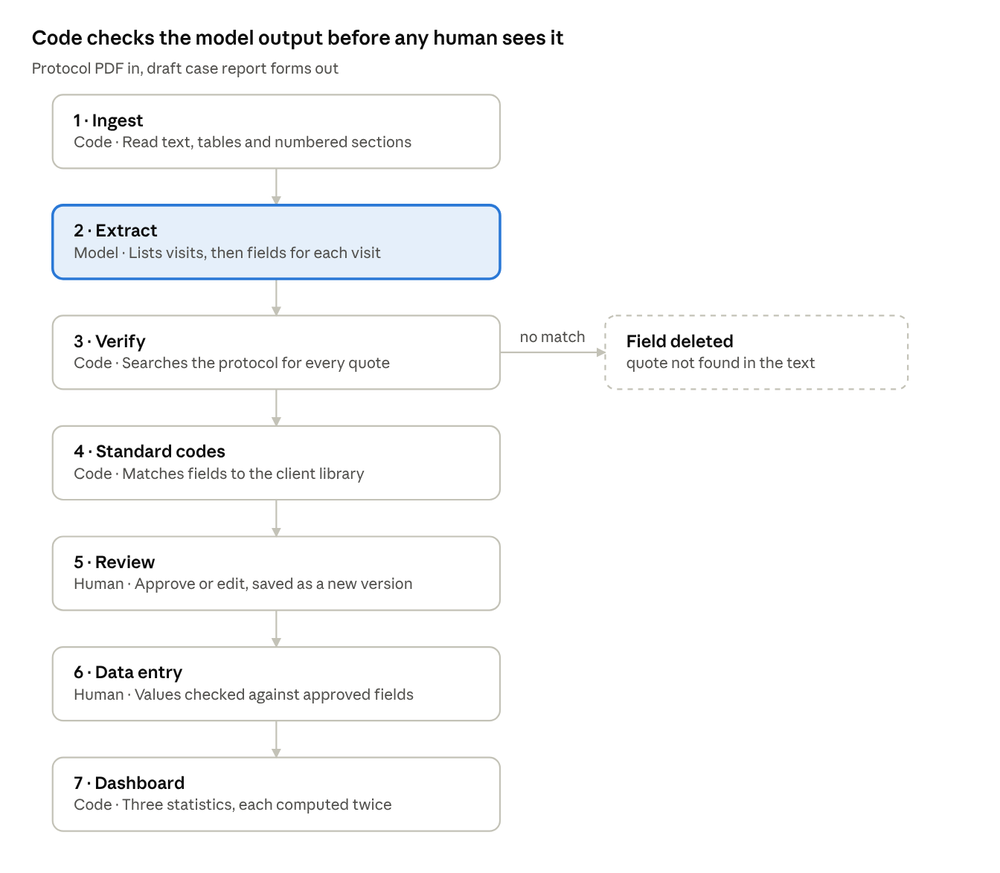

# eCRF Builder

BU Spark! Fall 2026 · DS519 · Client: Phoenix Clinical Research

A clinical trial protocol PDF goes in. Draft electronic case report forms
come out, one per study visit, with every field carrying the verbatim
sentence from the protocol that requires it. Code (not a model) then
searches the protocol for that sentence and deletes any field whose quote
cannot be found. A reviewer approves, synthetic data is entered through the
approved forms, and a dashboard reports statistics that a separate script
has independently recomputed.



Only stage two uses a language model. Reading the PDF, checking the quotes,
attaching standard codes and computing the statistics are ordinary code,
which is what makes the result auditable.

## Run it

Requires Python 3.11+ and Node 18+.

```bash
cd ecrf-prototype
cp .env.example .env     # defaults to the offline mock backend, no key needed
./run.sh                 # backend on :8000, frontend on :5173
```

Open <http://localhost:5173>, click **Load sample protocol**, then
**Extract**.

```bash
./run.sh test            # backend tests, expect 3 passed
./run.sh backend         # backend only
```

Stop the backend before running the tests. They delete `backend/ecrf.db`,
and a running server keeps a handle on the old file, after which every
write fails with "attempt to write a readonly database".

## Using a real model

`ECRF_BACKEND=mock` replays a recorded extraction of the bundled sample
protocol and works offline. It returns nothing for any other document, so a
real model is needed for real protocols. In `.env`:

```bash
ECRF_BACKEND=openai_compat
LLM_BASE_URL=https://api.openai.com/v1
LLM_API_KEY=sk-...
LLM_MODEL=gpt-5.1
```

Any provider speaking the OpenAI chat format works. `.env.example` has
blocks for Groq, Gemini and a self-hosted vLLM server. **`.env` is
gitignored. Never commit a key.**

Two practical notes from testing. Some providers count reserved output
tokens against a per-minute limit, so a request can be rejected as too
large even when the prompt is well inside the window. And free tiers around
8,000 tokens per minute cannot process a protocol much over 12 pages,
because the first call sends the whole document to ask what the visits are.

## What is in here

```
ecrf-prototype/
  backend/
    ecrf/            the pipeline and the API
      ingest.py      PDF to text, tables and numbered sections
      extract/       the model adapter; mock and OpenAI-compatible
      verify.py      the grounding check that deletes ungrounded fields
      cdash.py       attaches standard codes from the CDASH library
      stats/         the fixed registry of approved calculations
      api/           FastAPI routes
    verification/    independent statistics. Imports nothing from ecrf/
    data/            CDASH library, sample protocol, recorded fixture
    tests/
  frontend/
    src/api/         types.ts mirrors the backend schema
    src/pages/       Protocols, Review, DataEntry, Dashboard
test_protocols/      two real protocols from ClinicalTrials.gov
BUILD.md             the full original specification
```

## Continuous integration

`.github/workflows/ci.yml` runs on every push and pull request to `main`.

```
lint ─┐
      ├─► build
test ─┘
```

| Stage | What it does | Fails when |
| --- | --- | --- |
| Lint | `ruff` over the backend, `eslint` over the frontend | any lint error |
| Test | `pytest` against the offline mock backend | any test fails |
| Build | `tsc` type-check then `vite` bundle | type or bundle error |

Linting and testing run in parallel; the build declares `needs: [lint, test]`
so a bundle is only ever produced from code that passed both. The test job
publishes a pass/fail table to the run summary and uploads its JUnit XML;
the build job uploads the bundle.

Run the same checks locally:

```bash
cd ecrf-prototype/backend  && ruff check . && pytest -v
cd ecrf-prototype/frontend && npm run lint && npm run build
```

## Finding protocols to test with

Completed trials on ClinicalTrials.gov publish their protocol documents.

```bash
cd ecrf-prototype/backend
python scripts/fetch_ctgov_protocol.py --rank 20 --phase PHASE3 --industry
python scripts/fetch_ctgov_protocol.py NCT03541174
```

File size is a poor guide. The largest document found during testing was
31 MB and turned out to be a scan with no text layer, which the pipeline
refuses; a 3.5 MB file held 159 clean pages. The download step reports page
count, whether a text layer exists and a token estimate, which are the
three things that decide whether a protocol can be processed.

`test_protocols/` holds two that are known to work.

## Rules that are not negotiable

- No real patient data. Synthetic or approved de-identified only.
- No client material to unapproved services.
- No generated form used without qualified approval.
- No unsupported analysis attempted. Refuse instead.
- `verification/` imports nothing from `ecrf/`.

## Known limits

- The quote match threshold of 90 is a placeholder. It needs tuning against
  a real approved form.
- A quote is checked for existence, not for relevance. A general sentence
  can be cited by many fields, so grounding catches invented citations but
  not a real citation attached to a field it does not support.
- Section detection treats table-of-contents lines as sections, so the
  section cross-check is unreliable on long protocols and is not displayed.
- Models did not reliably flag a contradiction planted in the sample
  protocol. Treat "refuses to invent fields" as demonstrated and "catches
  contradictions" as not yet demonstrated.
- There is no login. The reviewer identity is a hardcoded placeholder.
- Scanned PDFs are refused rather than read.
